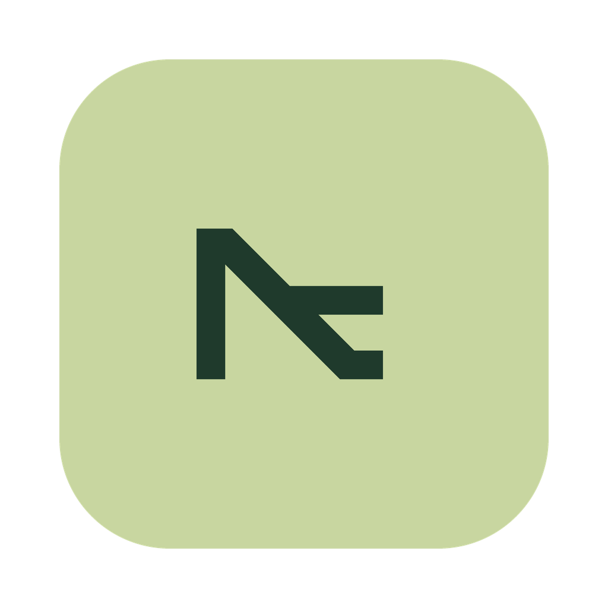
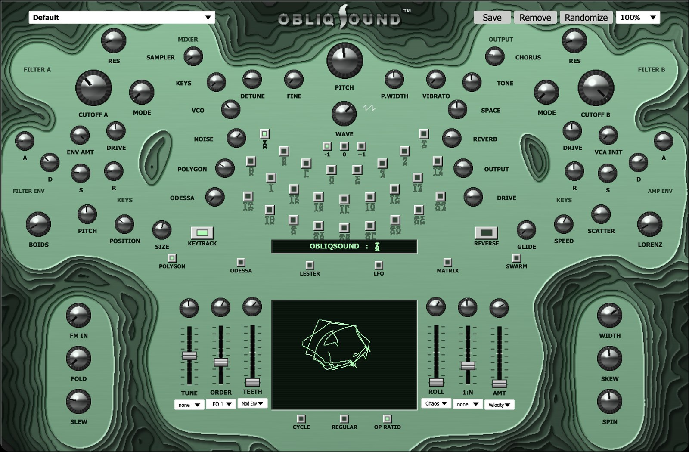
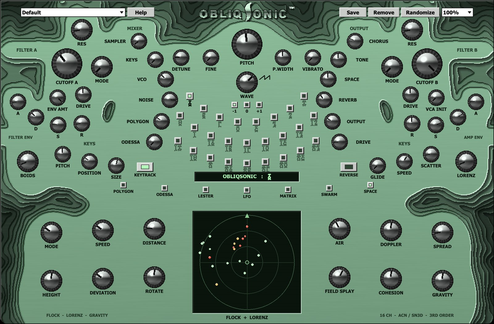

<p align="center">&nbsp;&nbsp;&nbsp;</p>

<h1 align="center">ObliqSound &nbsp;/&nbsp; ObliqSonic</h1>

<p align="center">
A polyphonic synthesizer and field-recording instrument with a living topographic panel, and its spatial twin:<br>
the same instrument as a third-order Ambisonics sound source for the IEM and SPARTA plug-ins.<br>
VST3, VST2 and a desktop app for each (macOS).
</p>



---

## What they are

**ObliqSound** grew out of the free [Kia instrument by AudioFB](https://www.kvraudio.com/product/kia-instrument-by-audiofb) (a small Cabbage/Csound synth with nature samples). It keeps that instrument's controls and presets, and adds a lot:

- **Polyphony** across every sound engine, with a polyphonic VCA INIT drone.
- **A polygonal oscillator** (inspired by the E-RM Polygogo) and **an additive oscillator** (after the XAOC Devices Odessa), alongside the virtual-analogue stack.
- **A dual morphing filter** after the Industrial Music Electronics *Bionic Lester*: LP > BP > HP > notch > comb, with five link modes.
- **A sampler** of 8 generated nature scenes and 18 field recordings, numbered in Ge'ez numerals. Each loop's start and end points drift slowly all the time, and the recordings can also be played from the keys.
- **A pin matrix** in the spirit of the EMS Synthi: 22 sources (including four MIDI CC rows) by 36 destinations.
- **Swarm modulation:** a boid flock and a Lorenz attractor moving every parameter.
- **A panel** in mirror symmetry, rendered like a late-90s plug-in. Its topographic landscape keeps morphing, and flows into a new shape when you change page.

**ObliqSonic** is the same instrument as a **sound source for a 16-channel, third-order Ambisonics** set-up (ACN / SN3D). It plays from MIDI and sends 16 channels to a decoder, with 22 moving points:

- Every voice is a point.
- Six copies of the field recording each have their own wandering loop points.
- The effects and the nature bed are points too.

The points fly on a 3-D flock, deviated Lorenz attractors or gravity wells, with Doppler, distance and air absorption. A SPACE page with a radar sets how they move.



**[The manual (PDF)](manual/ObliqSound_ObliqSonic_Manual.pdf)** covers every control, the matrix, the spatial side and the IEM/SPARTA set-up.

## Download and install

Download the zips from the [Releases page](../../releases/latest):

| File | What it is |
| --- | --- |
| ObliqSound-VST3-macOS.zip / ObliqSonic-VST3-macOS.zip | VST3 plug-ins |
| ObliqSound-VST2-macOS.zip / ObliqSonic-VST2-macOS.zip | VST2 plug-ins |
| ObliqSound-App-macOS.zip / ObliqSonic-App-macOS.zip | Desktop apps (each contains its own plug-in) |
| ObliqSound_ObliqSonic_Manual.pdf | The manual |

1. Unzip. Copy `.vst3` to `~/Library/Audio/Plug-Ins/VST3`, `.vst` to `~/Library/Audio/Plug-Ins/VST` and the apps to `/Applications`.
2. The builds are signed ad hoc, not notarised, so macOS will refuse them the first time. Clear the quarantine flag:
   ```sh
   xattr -dr com.apple.quarantine ~/Library/Audio/Plug-Ins/VST3/Obliq*.vst3 ~/Library/Audio/Plug-Ins/VST/Obliq*.vst /Applications/Obliq*.app
   ```
3. Rescan plug-ins in your DAW. Both plug-ins are listed under the manufacturer **Obliq**.

The plug-ins run on Apple silicon and Intel (macOS 11 or later). Each one is about 130 MB, mostly the rendered landscape frames and the recordings.

### The desktop apps

- **Audio and MIDI:** set them under **Options > Audio / MIDI Settings...**. Every MIDI input is enabled, including devices you plug in later.
- **Computer keyboard:** A W S E D F T G Y H U J K O L P ; ' play the notes. Z / X change the octave and C / V the velocity.
- **Memory:** each app remembers its sound, devices and window.
- **ObliqSonic output:** **Options > Output** chooses between **Stereo**, a decode to a virtual cardioid pair, and **16-channel Ambisonics** for an interface or virtual device with 16 outputs.

### ObliqSonic with IEM / SPARTA (REAPER)

1. Insert ObliqSonic on a track and set the track to **16 channels** (Route > Track channels: 16).
2. After it, add a decoder at **order 3, SN3D**: IEM **BinauralDecoder** for headphones, or IEM **AllRADecoder** / SPARTA **AmbiDEC** for speakers.
3. Optionally add IEM **EnergyVisualizer** to watch the sound move.

## Build from source

You need Python 3 with numpy, scipy, Pillow and reportlab, Csound 6 or 7 on the command line for the tests, CMake and a JUCE checkout for the apps (`JUCE_DIR=/path/to/JUCE`).

```sh
python3 -m venv .venv && .venv/bin/pip install numpy scipy pillow reportlab
./build.sh                                      # ObliqSound.vst3 -> build/
NAME=ObliqSonic ID=Oblc ./build.sh              # ObliqSonic.vst3
./build_vst2.sh                                 # VST2 (same NAME/ID variables)
NAME=ObliqSonic ./build_app.sh build/apps       # a desktop app
./make_release.sh                               # everything, zipped into dist/
```

- `engine.orc` is the whole Csound engine. ObliqSonic's spatial side is in its `#ifdef SONIC` blocks.
- `gen.py` writes the Cabbage panel and checks its symmetry. It also renders the topographic frames (cached in `src/.bgcache.json`; the first run takes several minutes) and writes the presets.
- `build.sh` wraps the result in the Cabbage 2.8 plug-in shell in `shell/` and gives it its own plug-in IDs and manufacturer name (`shell/patch_vendor.py`).
- `app/` is the JUCE desktop host, `host/` a headless test host, and `work/dbg.py` renders the engine with the Csound command line.
- `manual/mkmanual.py` builds the PDF.

## Human contributions

ObliqSound and ObliqSonic were written with Claude Code (Anthropic), working under the direction of their author, [femifleming](https://github.com/femifleming). This is what the author brought to them:

- **The starting point and the brief.** Take the Kia instrument, make it sound much better, with far more modulation and complexity, polyphonic in every engine, keeping its identity and adding rather than taking away.
- **The references.**
  - The E-RM Polygogo for the polygon oscillator.
  - The XAOC Devices Odessa for the additive oscillator.
  - The Industrial Music Electronics Bionic Lester for the filter section.
  - The EMS Synthi for the pin matrix.
  - The author's own spatial plug-ins, Mellyloon and Chloaeilius, for ObliqSonic.
- **The field recordings.** The 18 recordings are the author's own. The author chose to cut them into short 16-bit loops from the middle of each file, to put them in the original sampler squares, and to use an audio follower as a modulation source.
- **The modulation design.**
  - Boid and Lorenz modulation on every parameter.
  - A huge Synthi-style pin matrix that MIDI CCs can be patched into.
  - Field-recording loop points that drift slowly all the time.
  - Randomize that also picks a recording.
- **The name, logo and colour.** The author supplied the ObliqSound logo and its sage green (#73AE8A).
- **The look, through many rounds.**
  - Perfect mirror symmetry, then an organic layout instead of a grid.
  - The aesthetic of old 90s render plug-ins (STS Transition Synth, CamelPhat) at Windows 2000 pixel quality.
  - Topographic layers that darken outward, and terrain that morphs between pages.
  - A background that keeps morphing on its own. The author rejected a crossfading version and an edge-only version until the whole shape moved symmetrically.
  - Rejected an aluminium panel.
  - Ge'ez numerals for the recordings.
  - Where the page buttons go.
- **Sound checks.** The author caught the field-recording level rising too steeply and asked for the gain staging to be fixed.
- **ObliqSonic's concept.** A multichannel IEM / SPARTA encoder of this instrument, moved by flocking, boids, deviated Lorenz attractors and gravity. Each field recording is copied and flies around with its own modulators for its start and end points.
- **The formats and the release.** VST3 and VST2, desktop apps for both, a full PDF manual, and publishing it here with no Kia logos and a link to the original.

## Credits

- The original **[Kia instrument](https://www.kvraudio.com/product/kia-instrument-by-audiofb)** by AudioFB for Kia. ObliqSound uses its Cabbage plug-in shell and is built on its controls and presets. The DSP is new code. No Kia logos or artwork are included.
- [Cabbage](https://cabbageaudio.com) and [Csound](https://csound.com) run the engine. The desktop apps are built with [JUCE](https://juce.com).
- The ambisonic conventions follow the [IEM Plug-in Suite](https://plugins.iem.at) and [SPARTA](https://leomccormack.github.io/sparta-site/). The distance model follows the IEM RoomEncoder. No code from either is included.
- The polygon oscillator, the additive oscillator, the filter and the pin matrix are inspired by the E-RM Polygogo, the XAOC Devices Odessa, the Industrial Music Electronics Bionic Lester and the EMS Synthi. This is an unofficial project, not affiliated with any of these makers or with Kia.
